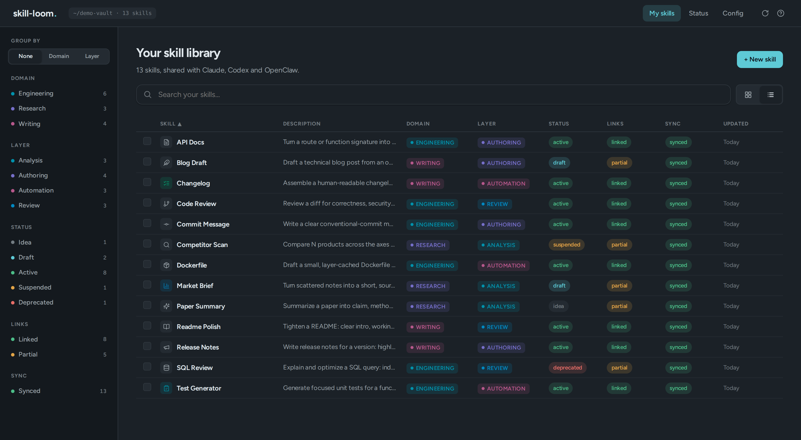
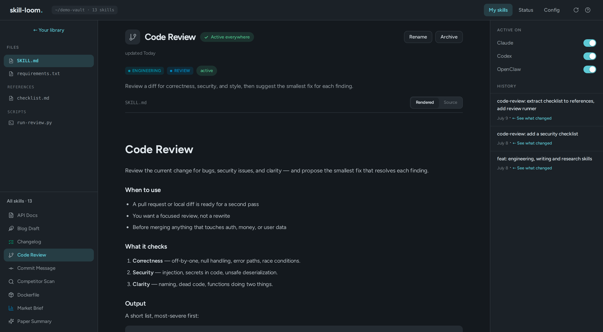

<div align="center">

# skill-loom

**One canonical, git-versioned vault of agent skills — symlinked into every runtime.**

[](https://www.npmjs.com/package/skill-loom)
[](LICENSE)
[](#requirements)

</div>

<p align="center">
  
</p>

Agent skills multiply: Claude Code reads `~/.claude/skills`, Codex reads `~/.agents/skills`, your own agents read somewhere else. Copies drift. skill-loom keeps **one vault** — a plain, git-versioned folder you own — and projects it into every runtime with symlinks. Edit once, every agent sees the same skill.

Runs headless from the CLI, or open the built-in dashboard with `skill-loom ui`.

## Quickstart

```bash
mkdir my-skills && cd my-skills
npx skill-loom init          # detects Claude Code / Codex, writes loom.json
npx skill-loom add my-skill --domain writing
npx skill-loom link          # dry-run: shows what would change
npx skill-loom link --apply  # creates the symlinks
```

## Commands

| Command                                                                         | What it does                                                                                                                                                                                          |
| :------------------------------------------------------------------------------ | :---------------------------------------------------------------------------------------------------------------------------------------------------------------------------------------------------- |
| `init`                                                                          | Create the vault: `loom.json` + `.archive/`, a `.gitignore`, and `git init` so the vault is its own repo. Detects known runtimes.                                                                     |
| `add <name> [--domain <d>] [--layer <l>] [--status <s>] [--description <text>]` | Scaffold a flat skill folder with a `SKILL.md`. New skills default to `draft`.                                                                                                                        |
| `link [--apply]`                                                                | Plan (dry-run) or apply symlinks for every active skill × consumer. Never overwrites anything that is not a symlink.                                                                                  |
| `status`                                                                        | Matrix of skill × consumer: `linked` / `served` (in-place) / `missing` / `broken` / `foreign`.                                                                                                        |
| `doctor`                                                                        | Validate names, frontmatter, duplicates, broken and orphan links (exit 1 if problems). Also runs hygiene checks that only warn — unless [`lint.strict`](#linting-optional) promotes them to failures. |
| `archive <name> [--apply]`                                                      | Move a skill into `.archive/` (hidden from runtimes) and remove its links.                                                                                                                            |
| `migrate <old> <new> [--apply]`                                                 | Rename a skill everywhere: folder, frontmatter, links.                                                                                                                                                |
| `ui [--port N] [--host ADDR] [--no-open]`                                       | Local dashboard in your browser: library, status grid, git changes, bulk actions, editable rules. Binds `127.0.0.1`; a non-loopback `--host` needs an explicit opt-in.                                |
| `sync [--apply]`                                                                | Sync the vault with its git remote: auto-commit, `pull --rebase`, push. Dry-run by default.                                                                                                           |

`link`, `archive`, `migrate` and `sync` are **dry-run by default** — nothing changes without `--apply`.
Exit codes: `0` ok · `1` problems found · `2` usage/config error (CI- and git-hook-friendly).

## The vault

```
my-skills/
├── loom.json            # consumers, ignore list, name casing, lint rules
├── my-skill/
│   └── SKILL.md         # frontmatter `name:` must equal the folder name
└── .archive/            # archived skills, hidden from every runtime
```

The vault is flat: one folder per skill, taxonomy comes from `domain`/`layer`
frontmatter rather than nested category directories.

`loom.json`:

```json
{
  "schema": 1,
  "consumers": {
    "claude": "~/.claude/skills",
    "codex": "~/.codex/skills"
  },
  "ignore": [".git", "node_modules", "__pycache__", ".venv"],
  "names": { "forpros": "ForPros" }
}
```

A symlink consumer is just a name and a path — add your own runtimes freely.
`init` pre-fills the runtimes it detects on your machine (Claude Code, Codex,
Cursor, opencode, Gemini CLI, Amp, Windsurf, Goose, Mistral Vibe, and the shared
`~/.agents/skills` pool); the dashboard's Config page offers the rest as
one-click additions. `names` overrides word casing in titles and labels.

### In-place consumers

Some runtimes don't want a symlinked directory — they read a list of skill
directories straight from their own config. Declare those as **in-place**
consumers: skill-loom leaves the files in the vault and just registers the vault
path in the runtime's config array, toggled live from the dashboard.

```json
{
  "consumers": {
    "openclaw": {
      "mode": "in-place",
      "servedVia": {
        "file": "~/.openclaw/loom.json",
        "jsonPath": "skills.load.extraDirs"
      }
    }
  }
}
```

## SKILL.md frontmatter

The dashboard is driven by a few optional frontmatter fields — use your own
vocabulary, every value gets a stable color automatically:

| Field         | Required | What it does                                                                                                                                          |
| ------------- | -------- | ----------------------------------------------------------------------------------------------------------------------------------------------------- |
| `name`        | yes      | Must equal the folder name (`doctor` checks it).                                                                                                      |
| `description` | no       | Shown on cards and in the table; it is also what your agents read to decide when to use the skill.                                                    |
| `domain`      | no       | Who the skill belongs to (a brand, a project, `cross`). Groups the library and feeds the sidebar filter.                                              |
| `layer`       | no       | What kind of work it does (e.g. `tool`, `review`, `authoring`). The orthogonal axis: chips, grouping, filter.                                         |
| `status`      | no       | Lifecycle: `idea` / `draft` / `active` / `suspended` / `deprecated`. Absent is treated as `active`; only active skills are linked and strictly gated. |
| `icon`        | no       | A line-icon name for the skill tile (NotePlan-style).                                                                                                 |
| `icon-color`  | no       | A Tailwind-ish token (e.g. `teal-500`) overriding the tile hue.                                                                                       |

Skills without `domain`/`layer` land in an "Other" group — everything keeps
working, the taxonomy only adds structure.

## Linting (optional)

`doctor` always runs two built-in hygiene checks — an H1 that drifts from the
skill name, and machine-specific absolute paths (`/home/…`, `/Users/…`) in a
guide — as **warnings** that never fail the exit code. An optional `lint` block
in `loom.json` adds content checks and can turn every finding into a failure,
so a vault can enforce its own conventions in CI or a pre-commit hook. Edit it by
hand, or from the dashboard's Config → Rules console with a live impact preview:

```json
{
  "lint": {
    "strict": false,
    "descriptionMinChars": 250,
    "descriptionMaxChars": 400,
    "bodyMaxLines": 120,
    "forbidBodyPatterns": ["\\b\\d{1,3}(?:\\.\\d{1,3}){3}\\b"],
    "requireSections": ["Policy"],
    "requireTaxonomy": ["domain", "layer"],
    "allowedDomains": ["my-brand", "cross"],
    "allowedLayers": ["tool", "engine", "review"]
  }
}
```

Every field is opt-in — an absent block leaves only the two built-in warnings.
With `strict: true`, findings on active skills print in red and `doctor` exits 1;
non-active skills stay advisory. `requireSections` matches a heading whose text
starts with the given title (so `## Policy (use / do-not-use)` satisfies
`"Policy"`).

`descriptionMinChars` flags descriptions shorter than the floor (pair it with
`descriptionMaxChars` for a range). `forbidBodyPatterns` is a list of regular
expressions; a body matching any of them is flagged — use it for machine
addresses the two built-in path checks miss, e.g. IPs or hostnames. A skill can
opt out of one finding by declaring a waiver in its frontmatter, when the
content is essential — `length-waiver` exempts `bodyMaxLines` (an inseparable
runbook), `forbid-waiver` exempts `forbidBodyPatterns` (e.g. documented internal
topology that is the skill's substance):

    metadata:
      lint:
        length-waiver:
          reason: "Operational runbook — inseparable without harming the flow."
        forbid-waiver:
          reason: "Internal network topology is the runbook's essence."

## Dashboard

Prefer buttons over flags? `skill-loom ui` starts a local dashboard — a single
self-contained page, no external dependencies, nothing leaves your machine.



- **My skills** — your library as a sortable table (or a card grid, <kbd>g</kbd>
  toggles), grouped by `domain` or `layer` with per-value colors and chips. The
  sidebar filters by domain, layer, lifecycle status, link state and git sync
  state, composing with full-text search. Each row answers the operational
  questions at a glance: lifecycle, links (`linked` / `partial` / `not linked` /
  `conflict`) and sync (`synced` / `to commit` / `to push` / `to pull`).
  **Select many** (checkbox, Cmd-click, Shift-range) and a right-click menu runs
  bulk actions — set status or taxonomy, archive, restore, pattern-rename — each
  previewed as a dry-run before it writes.
- **Skill page** — a three-pane view: files on the left, the guide rendered as a
  clean document (frontmatter as taxonomy chips and a metadata card; syntax
  highlighting in the source view) in the centre, and runtime toggles + git
  history on the right. In-place consumers activate/deactivate right there.
- **Config** — a settings console: browse the vault's governance docs with their
  history, add runtimes, edit name casing, and tune the `lint` rules gate with a
  live preview of which skills a change would newly flag or clear.
- **Health & recent changes** — problems explained in plain sentences, one-click
  "Fix links", sync status across machines, and what your agents edited since the
  last save, ready to review and push.



Press <kbd>?</kbd> anywhere for the keyboard-shortcut map. Every write action
shows the dry-run plan before confirming — same semantics as the CLI, same
guarantee: nothing that is not a symlink is ever touched. The dashboard binds to
`127.0.0.1` only; its write endpoints have no authentication, so exposing it on a
non-loopback address takes a deliberate extra flag.

## Use it on more than one machine

The vault is a git repository, so syncing is just a private remote:

```bash
# machine A (where the vault lives)
cd my-skills && git remote add origin git@github.com:you/skills-vault.git
skill-loom sync --apply

# machine B
git clone git@github.com:you/skills-vault.git my-skills
cd my-skills && skill-loom link --apply

# any machine, any time
skill-loom sync            # dry-run: shows what would happen
skill-loom sync --apply    # commit local edits, pull --rebase, push
```

Links stay local to each machine (they point at that machine's copy); only the
vault content travels. On a rebase conflict, sync stops and tells you how to
resolve — it never forces anything.

## Requirements

Node ≥ 20, macOS or Linux. Windows is not supported (symlink semantics differ — PRs welcome).

## Why symlinks

The vault is the single source of truth: history in git, one place to edit, review and back up. Runtimes get a live view, not a copy — there is nothing to sync and nothing to drift. This tool is extracted from the skill registry I run in production for a fleet of 7 agents.

## License

MIT
